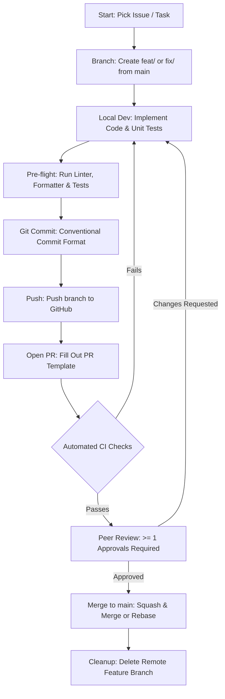

# SahkaarX Team Shared Repository 🚀

[](https://github.com/parth-mehta95/sahkaarx-stage-portfolio-7d66631c)
[](https://opensource.org/licenses/MIT)
[](https://www.python.org/)
[](https://github.com/psf/black)
[-green.svg)](https://mypy-lang.org/)
[](https://github.com/parth-mehta95/sahkaarx-stage-portfolio-7d66631c/pulls)

Welcome to the shared collaborative repository for the **SahkaarX Engineering Team**. This repository establishes the foundational version control workflows, standardized Pull Request (PR) guidelines, code review protocols, and technology stack choices for consistent, high-quality team collaboration.

---

## 📌 Repository Overview & Deliverables

| Metric / Requirement | Specification |
| :--- | :--- |
| **Repository Name** | `sahkaarx-stage-portfolio-7d66631c` |
| **Public Clone URL** | `https://github.com/parth-mehta95/sahkaarx-stage-portfolio-7d66631c.git` |
| **Web Repository URL** | [https://github.com/parth-mehta95/sahkaarx-stage-portfolio-7d66631c](https://github.com/parth-mehta95/sahkaarx-stage-portfolio-7d66631c) |
| **Visibility** | **Public & Cloneable** |
| **Default Branch** | `main` |
| **Primary Language** | **Python 3.10+** (Strict typing & PEP 8) |
| **Minimum Artifacts** | `README.md`, Initial Commit, PR Guidelines, `.gitignore` |

---

## 💻 Language & Technology Choice

### Primary Language: **Python 3.10+**

Our team has standardized on **Python 3.10+** as the canonical language for this project and collaborative portfolio work.

### Rationales:
1. **Expressiveness & Readability:** Python's clean syntax allows teams to quickly write, comprehend, and audit code during peer reviews without boilerplate friction.
2. **Modern Static Typing:** Utilizing Python's `typing` module alongside `mypy --strict` guarantees compile-time contract enforcement and interface clarity while retaining runtime flexibility.
3. **Rich Ecosystem:** Unmatched support for data structures, automation, testing (`pytest`), and cloud microservices.
4. **Standardized Tooling:**
   - **Formater:** `black` (88-character line limit)
   - **Linter & Import Sorter:** `ruff` or `flake8` + `isort`
   - **Type Checker:** `mypy` (strict mode enabled)
   - **Test Runner:** `pytest` (with high test coverage)

---

## 🔄 Pull Request (PR) Workflow Lifecycle

To ensure maintainability, code quality, and shared knowledge across the team, all changes must follow this standardized PR workflow:



---

## 📋 Comprehensive PR Guidelines

### 1. Branch Naming Conventions
All branch names must be lowercase, hyphen-delimited, and prefixed with the category of change:

| Prefix | Usage / Purpose | Example |
| :--- | :--- | :--- |
| `feat/` | New user-facing or technical feature | `feat/data-loader-module` |
| `fix/` | Bug fixes and patches | `fix/null-pointer-exception` |
| `docs/` | Documentation additions or updates | `docs/update-pr-guidelines` |
| `refactor/` | Code refactoring without behavior change | `refactor/optimize-sql-queries` |
| `test/` | Adding or updating unit/integration tests | `test/add-validation-tests` |
| `chore/` | Tooling, configuration, or dependency updates | `chore/upgrade-pytest` |

```bash
# Example: Creating a new feature branch
git checkout main
git pull origin main
git checkout -b feat/data-loader-module
```

---

### 2. Commit Message Standards (Conventional Commits)
Commits should be atomic and describe a single logical unit of change. We follow the [Conventional Commits](https://www.conventionalcommits.org/) specification:

**Format:**
```text
<type>(<scope>): <short imperative summary>

[optional detailed body explaining motivation and context]

[optional footer referencing issues, e.g., Closes #12]
```

**Types:**
- `feat`: A new feature
- `fix`: A bug fix
- `docs`: Documentation only changes
- `style`: Formatting, missing semi-colons, whitespace (no code change)
- `refactor`: A code change that neither fixes a bug nor adds a feature
- `test`: Adding missing tests or correcting existing tests
- `chore`: Changes to build process or auxiliary tools

**Examples:**
```bash
git commit -m "feat(loader): add type-hinted iris data ingestion function"
git commit -m "test(validation): add boundary check test cases for sepal length"
git commit -m "docs(readme): add pull request guidelines and language specifications"
```

---

### 3. Pre-Submission Checklist
Before submitting a PR for review, the author **must** verify the following locally:

- [ ] Code follows formatting standards (`black .`).
- [ ] Code passes linting without warnings (`ruff check .` or `flake8`).
- [ ] Static type checker passes cleanly (`mypy --strict .`).
- [ ] All unit and integration tests pass (`pytest -v`).
- [ ] No extraneous files, secrets (`.env`), or large temporary artifacts are committed.
- [ ] The feature branch is rebased on the latest `main` branch.

---

### 4. Pull Request Structure & Template
When opening a PR against `main`, title it clearly and populate the team PR template:

```markdown
## Summary of Changes
- Implemented `data_loader.py` with type-annotated function signatures.
- Added comprehensive unit tests in `test_data_loader.py`.

## Motivation & Context
Provides the base data ingestion layer required for the ML pipeline.

## Testing Performed
- Ran `pytest test_data_loader.py` (10 passed, 0 failed).
- Validated type safety with `mypy --strict data_loader.py`.

## Checklist
- [x] Code adheres to repository style guides
- [x] Unit tests added and passing
- [x] Documentation updated
- [x] No breaking API changes introduced
```

---

### 5. Peer Code Review & Reviewer Etiquette

#### For Authors:
- **Keep PRs small:** Ideal PR size is under 300–400 lines of diff. Smaller PRs receive faster and more thorough reviews.
- **Provide context:** Link relevant tickets and explain the design trade-offs made.
- **Respond promptly:** Treat review comments collaboratively; resolve discussions once feedback is implemented.

#### For Reviewers:
- **Turnaround time:** Aim to review PRs within 24 business hours.
- **Constructive tone:** Focus on the code, not the person. Use prefixes to clarify severity:
  - `[Blocker]`: Must be fixed before merge (e.g., security vulnerability, logic bug).
  - `[Suggestion]`: Recommended improvement (e.g., cleaner syntax, better performance).
  - `[Question]`: Seeking clarification on approach or intent.
  - `[Nitpick]`: Minor cosmetic preference (non-blocking).
- **Praise excellence:** Acknowledge clean, well-architected solutions.

---

### 6. Merge Strategy
- **Approval Gate:** Minimum **1 approving review** from a code owner / peer reviewer.
- **CI Gate:** All automated GitHub Actions checks must pass (green).
- **Merge Method:**
  - **Squash and Merge:** Recommended for multi-commit feature branches to keep `main` history clean and linear.
  - **Rebase and Merge:** Used when individual commits are well-curated and need preservation.
  - Delete feature branch immediately after merge.

---

## 🛠️ Step-by-Step Repository Setup & Git Walkthrough

### Step 1: Clone the Repository
```bash
git clone https://github.com/parth-mehta95/sahkaarx-stage-portfolio-7d66631c.git
cd sahkaarx-stage-portfolio-7d66631c
```

### Step 2: Verify Remote Origin & Branch
```bash
git remote -v
# origin  https://github.com/parth-mehta95/sahkaarx-stage-portfolio-7d66631c (fetch)
# origin  https://github.com/parth-mehta95/sahkaarx-stage-portfolio-7d66631c (push)

git branch --show-current
# main
```

### Step 3: Add & Review Tracked Artifacts
```bash
git status
git add README.md .gitignore .github/
```

### Step 4: Make Initial Commit
```bash
git commit -m "feat(repo): initialize repository with PR guidelines, language choice, and review standards"
```

### Step 5: Push to Main Branch
```bash
git push -u origin main
```

---

## 📂 Repository Layout

```text
sahkaarx-stage-portfolio-7d66631c/
├── .github/
│   └── pull_request_template.md        # Standard PR template for GitHub
├── .gitignore                          # Standard Python, IDE, and OS ignore rules
├── README.md                           # Team guidelines, PR workflow, and repository documentation
└── practice/
    └── week-01-initialize-git-repository-and-document-pr-workfl/
        ├── README.md                   # Week 1 practice documentation & deliverables
        ├── simulate_pr_workflow.ps1    # PowerShell simulation script for PR workflow
        └── simulate_pr_workflow.sh     # Bash simulation script for PR workflow
```

---

## 🤝 Contributing

We welcome contributions from all team members! Please read through our [PR Guidelines](#-comprehensive-pr-guidelines) before opening a pull request.

For questions, open a GitHub Discussion or reach out to the repository maintainer.
