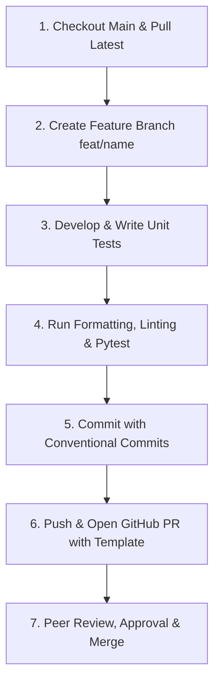

# Initialize Git Repository and Document PR Workflow 🚀

[](https://github.com/parth-mehta95/sahkaarx-stage-portfolio-7d66631c)
[](https://www.python.org/)
[](https://opensource.org/licenses/MIT)

## 📌 Task Brief
Set up a GitHub repository, create initial commit, and write pull request guidelines in README to establish version control foundations.

## 🎯 Scenario
Your team needs a shared repository with clear PR guidelines for code reviews and collaboration.

## 📦 Deliverables & Success Criteria
- **Deliverables:** GitHub repository with comprehensive README.
- **Success Criteria:** Repository is **public** and **cloneable**.
- **Accepted Formats:** GitHub repository URL: [https://github.com/parth-mehta95/sahkaarx-stage-portfolio-7d66631c](https://github.com/parth-mehta95/sahkaarx-stage-portfolio-7d66631c)
- **Minimum Artifacts:**
  - `README.md`
  - Initial commit

---

## 🔗 Repository Information

| Field | Detail |
| :--- | :--- |
| **GitHub Repository URL** | [https://github.com/parth-mehta95/sahkaarx-stage-portfolio-7d66631c](https://github.com/parth-mehta95/sahkaarx-stage-portfolio-7d66631c) |
| **Clone URL (HTTPS)** | `https://github.com/parth-mehta95/sahkaarx-stage-portfolio-7d66631c.git` |
| **Clone Command** | `git clone https://github.com/parth-mehta95/sahkaarx-stage-portfolio-7d66631c.git` |
| **Default Branch** | `main` |
| **Primary Language** | Python 3.10+ |

---

## 💻 Language Choice & Engineering Rationale

### Selection: **Python 3.10+**

For our engineering team's shared repository and ongoing portfolio development, **Python 3.10+** has been selected as the standard development language.

### Rationale:
1. **Clarity & Readability:** Python's clean, expressive syntax minimizes cognitive overhead during pull request code reviews, facilitating faster feedback cycles.
2. **Type Safety with Modern Type Annotations:** Python 3.10 introduces native union syntax (`X | Y`) and enhanced structural pattern matching. Enforcing `mypy --strict` guarantees contract adherence without runtime overhead.
3. **Ecosystem & Tooling Maturity:** Rich ecosystem for machine learning, data engineering, APIs, and automation, coupled with mature tooling:
   - `black`: Deterministic code formatting
   - `flake8` / `ruff`: Fast, comprehensive linting
   - `mypy`: Static type analysis
   - `pytest`: High-velocity unit and integration testing

---

## 🔄 Team Pull Request (PR) Workflow

To maintain code health and encourage continuous collaboration, all team contributors follow this 7-step PR workflow:



### 1. Branch Strategy
- Never commit directly to `main`.
- Branch naming convention: `<type>/<short-description>`:
  - `feat/<feature-name>`: New feature or module
  - `fix/<bug-name>`: Bug fix
  - `docs/<doc-topic>`: Documentation changes
  - `refactor/<target>`: Code restructuring
  - `test/<test-suite>`: Unit/integration tests

```bash
git checkout main
git pull origin main
git checkout -b feat/data-validation-module
```

### 2. Conventional Commit Messages
Commits must be atomic with clear imperative intent:
- `feat(scope): add new feature`
- `fix(scope): fix identified issue`
- `docs(scope): update documentation`
- `test(scope): add automated unit test cases`
- `chore(scope): update dependencies or tooling config`

Example:
```bash
git commit -m "feat(repo): initialize repository with PR guidelines and language choice"
```

### 3. Local Verification Before Pushing
Run automated checks prior to opening a PR:
```bash
# Format code
black .

# Static type checking
mypy --strict .

# Run test suite
pytest -v
```

### 4. Opening the Pull Request
- Target base branch: `main`.
- Fill out all sections in the [PR Template](file:///d:/challengers%20testing/28-oct-2026/sahkaarx-stage-portfolio-7d66631c/.github/pull_request_template.md).
- Keep pull requests focused: ideally under 400 lines of diff.

### 5. Peer Review Standards
- **Review SLA:** Within 24 business hours.
- **Tone:** Constructive, collaborative, and actionable.
- **Review Prefixes:**
  - `[Blocker]`: Must be resolved before merging.
  - `[Suggestion]`: Non-blocking recommendation.
  - `[Nitpick]`: Minor cosmetic feedback.
- **Approval Requirement:** Minimum 1 peer approval required.

### 6. Merge & Cleanup
- Use **Squash and Merge** (or Rebase and Merge) to maintain a clean linear Git history.
- Delete the remote feature branch upon successful merge.

---

## 🛠️ Step-by-Step Initial Setup & Push Walkthrough

```bash
# 1. Initialize local repository (if not already cloned)
git init -b main

# 2. Add remote origin
git remote add origin https://github.com/parth-mehta95/sahkaarx-stage-portfolio-7d66631c.git

# 3. Verify remote
git remote -v

# 4. Stage artifacts
git add README.md .gitignore .github/ practice/

# 5. Create initial commit
git commit -m "feat(repo): initialize repository with PR guidelines and language choice"

# 6. Push to main
git push -u origin main
```

---

## 🧪 Simulation Scripts

To simulate or automate the PR workflow lifecycle for practice:
- **PowerShell (Windows):** [`simulate_pr_workflow.ps1`](file:///d:/challengers%20testing/28-oct-2026/sahkaarx-stage-portfolio-7d66631c/practice/week-01-initialize-git-repository-and-document-pr-workfl/simulate_pr_workflow.ps1)
- **Bash (Linux/macOS):** [`simulate_pr_workflow.sh`](file:///d:/challengers%20testing/28-oct-2026/sahkaarx-stage-portfolio-7d66631c/practice/week-01-initialize-git-repository-and-document-pr-workfl/simulate_pr_workflow.sh)